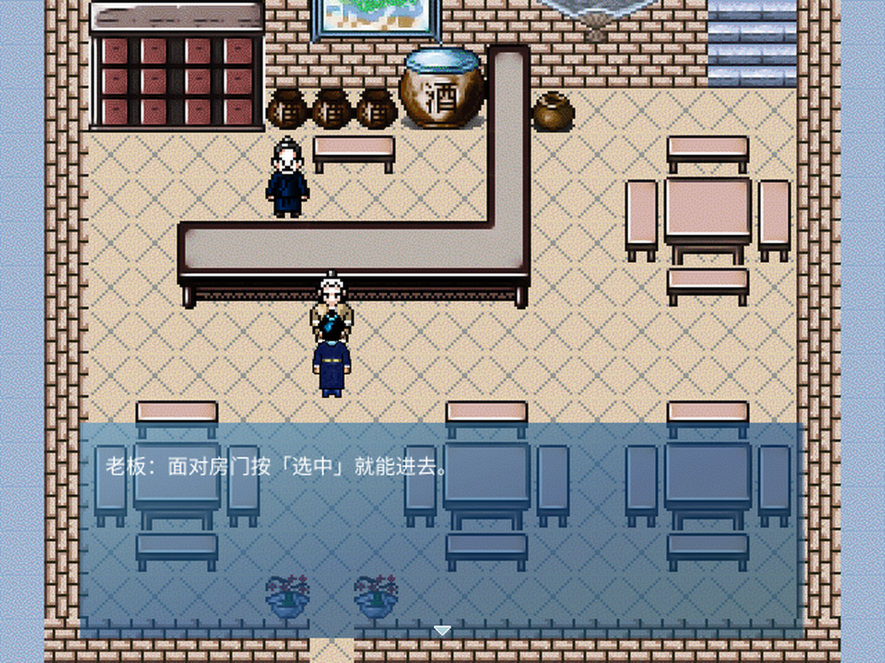
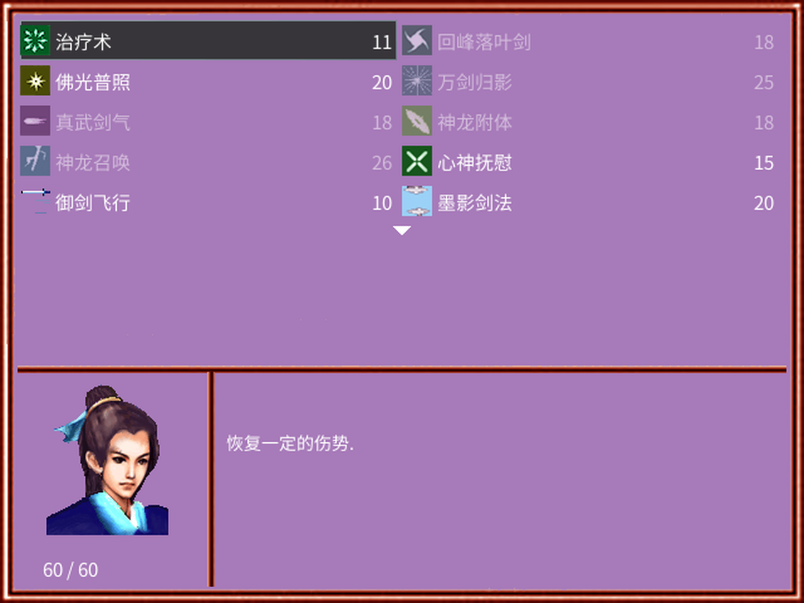
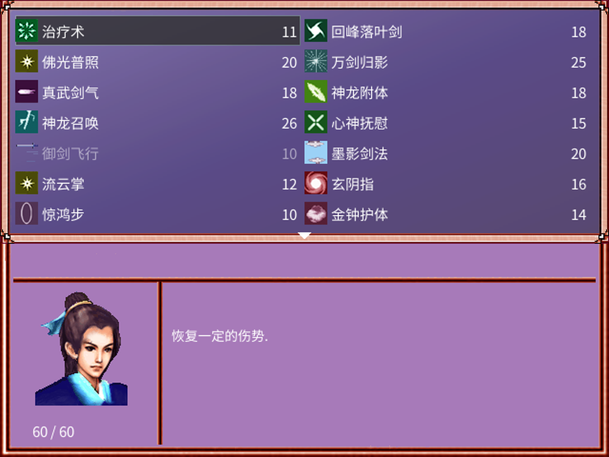
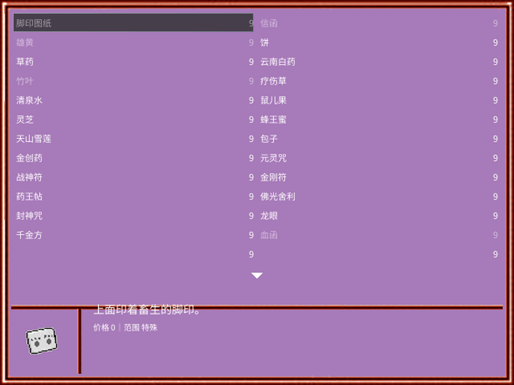
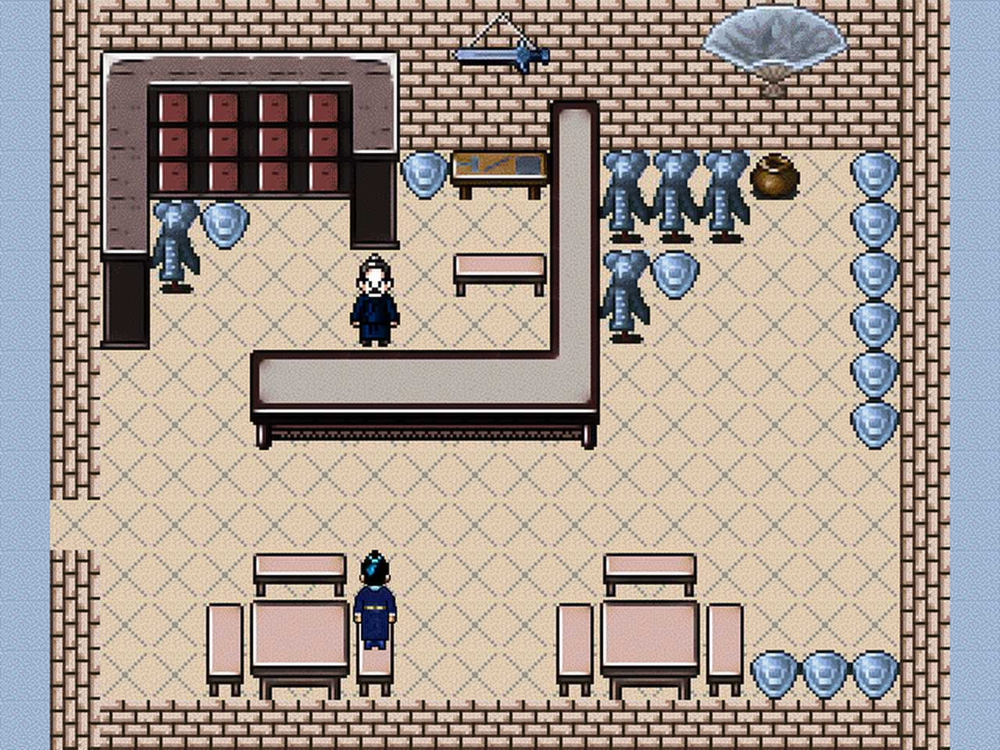

# 天降风云录16-10 Android 移植

> 基于 [mkxp-z](https://github.com/mkxp-z/mkxp-z) 的 RPG Maker XP Android 运行壳。

**仓库：** <https://github.com/wushilian/TianJiangFengYunLu>

---

## 简介

这是《天降风云录16-10》的 Android 移植工程，包含：

- Android 启动、解包、存档备份与 `core.zip` 热更新；
- mkxp-z 在 Android 上的全屏、字体、地图和触屏适配；
- 游戏运行所需的兼容脚本与工具；
- 可直接安装的 APK 发布包（见 Releases）。

当前构建：**1.5.29（versionCode 49）**。

> 仓库包含可修改的游戏数据 `tianjiang_game/`（Data、Graphics、Audio、Fonts）和 ARM 原生库。  
> `game.zip` 和 APK 构建产物不纳入版本库；APK 由 GitHub Actions 构建并发布到 Releases。

---

## 截图

| 标题画面 | 游戏画面 |
| --- | --- |
|  |  |

| 南疆 | 南疆提示 |
| --- | --- |
|  |  |

| 技能菜单 | 战斗技能 |
| --- | --- |
|  |  |

| 物品列表 | 南疆防具店 |
| --- | --- |
|  |  |

| 真结局 |
| --- |
|  |

---

## 目录结构

```text
TianJiangFengYunLu/
├── app/                    Android 应用模块
│   ├── src/main/java/      Android 壳与 mkxp-z 接入
│   ├── src/main/res/       资源与布局
│   ├── src/main/assets/    core.zip（热更新包）
│   └── build.gradle
├── tianjiang_game/         游戏本体数据（Data/Graphics/Audio/Fonts）
├── app/src/main/jniLibs/   ARM64 / ARMv7 原生库
├── tools/                  构建、安装与数据脚本
├── docs/screenshots/       README 截图
├── gradle/                 Gradle Wrapper
├── gradlew / gradlew.bat
├── settings.gradle
└── README.md
```

游戏数据已在 `tianjiang_game/` 中，可直接修改：

```text
tianjiang_game/
├── Data/       地图、数据库、脚本
├── Graphics/   角色、战斗图、图块、图片
├── Audio/      BGM、BGS、ME、SE
├── Fonts/      游戏字体
├── Game.ini
├── mkxp.json
└── mkxp_compat.rb
```

ARM64 / ARMv7 原生库已放在：

```text
app/src/main/jniLibs/arm64-v8a/
app/src/main/jniLibs/armeabi-v7a/
```

`app/src/main/assets/game.zip` 由 `tianjiang_game/` 通过脚本生成，不提交到 Git。

---

## 构建

### 环境

- JDK 17
- Android SDK（compileSdk 36、build-tools 36.0.0）
- 仓库自带 Gradle Wrapper

### 步骤

1. 生成游戏数据包（仓库已带 `tianjiang_game/`）：

   ```bash
   python3 tools/build_game_zip.py
   ```

   会在 `app/src/main/assets/` 下生成 `game.zip` 和 `core.zip`。

2. 原生库已在 `app/src/main/jniLibs/` 中，无需额外准备。

3. 写入 `local.properties`：

   ```properties
   sdk.dir=/path/to/android-sdk
   ```

4. 构建：

   ```bash
   ./gradlew clean assembleDebug
   ```

5. 产物：

   ```text
   app/build/outputs/apk/debug/app-debug.apk
   ```

> 仅支持 ARM64 / ARMv7（`arm64-v8a`、`armeabi-v7a`）。

### 生成 game.zip / core.zip

`tools/build_game_zip.py` 会同时生成：

- `app/src/main/assets/game.zip`
- `app/src/main/assets/core.zip`

仓库内已包含 `tianjiang_game/`；修改 Data、Graphics、Audio 或 Fonts 后运行：

```bash
python3 tools/build_game_zip.py
```

脚本会重新生成 `game.zip`，并把热更新文件重新打包为 `core.zip`。

---

## core.zip 热更新

- 应用启动时检查 `core.zip`，只刷新小型脚本/数据文件；
- 已解包用户使用 `.ready_v28` 标记，不需要重新解包 60MB；
- 当前 `core.zip` 包含 28 个文件，包括脚本、配置、系统数据和相关地图。

---

## 兼容性

- `applicationId`：`com.tianjiang.fengyun`
- 仅支持 ARM：`arm64-v8a` / `armeabi-v7a`
- 使用原 debug 签名，可覆盖旧测试包；正式分发请自行配置签名
- 更新保留 `Save*.rxdata`，升级前建议手动备份存档
- 需要 Android 6.0（API 23）及以上

---

## 自动发布

推送 `v*` 标签会触发 GitHub Actions：

- 构建 `assembleDebug`；
- 自动创建/更新对应 Release；
- 上传 `app-debug.apk` 作为 Release 附件。

工作流文件：`.github/workflows/release.yml`。

## 下载

APK 见仓库的 **Releases** 页面：

<https://github.com/wushilian/TianJiangFengYunLu/releases/latest>

---

## 免责声明

本项目用于 Android 移植、兼容性研究和学习交流，仓库内包含游戏数据以便修改和二次开发。  
《天降风云录16-10》的原始游戏数据、图片、音频、字体及其他素材版权归原作者及相应权利方所有；如果你不是权利人，请仅用于学习研究，不要用于商业分发。若权利人提出异议，请删除对应素材。

---

**仓库：** <https://github.com/wushilian/TianJiangFengYunLu>
